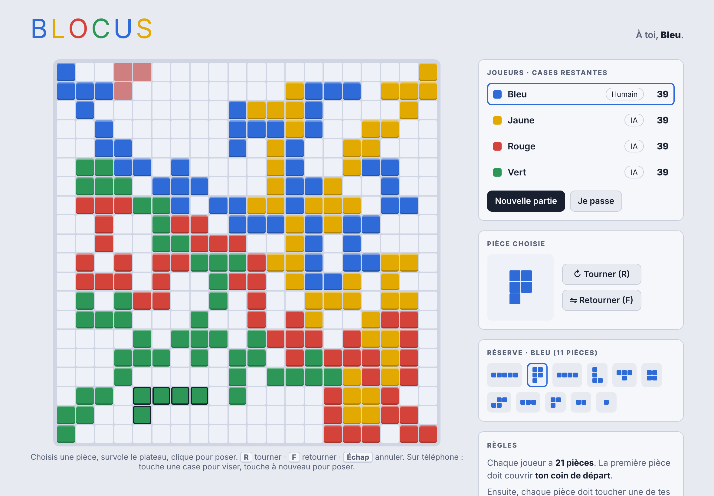

# Blocus

Jeu de société de placement de pièces pour 4 joueurs. Il se joue dans le navigateur, entre amis à distance ou contre l'ordinateur.

## Jouer

Le site se publie avec GitHub Pages : va dans **Settings → Pages**, choisis la branche `main` puis le dossier `/ (root)`. Le jeu sera alors disponible à l'adresse `https://tom68160.github.io/Blocus/`. C'est cette adresse qu'il faut mettre dans ton Hub.

Aucune installation et aucun compte ne sont nécessaires.

## Jouer avec ses amis

1. Chacun ouvre le site et choisit un pseudo.
2. Les joueurs connectés apparaissent dans la liste **En ligne**.
3. Clique sur **Inviter** à côté d'un ami. Il reçoit l'invitation directement sur son écran et choisit **Rejoindre** ou **Refuser**. L'invitation expire au bout de 60 secondes.
4. Une partie accueille jusqu'à 4 joueurs. Les places libres sont jouées par l'ordinateur.
5. Clique sur **Lancer la partie**.

La personne qui crée la partie en est l'hôte : c'est son navigateur qui arbitre les coups. Si un invité se déconnecte plus de 30 secondes, l'ordinateur joue à sa place. Si l'hôte se déconnecte, la partie s'arrête. Recharger la page ne fait pas perdre la partie en cours.

### Bon à savoir

- Les échanges passent par un serveur de messages public et gratuit (HiveMQ). Le jeu n'a besoin d'aucun serveur à toi. En contrepartie, ce serveur ne garantit pas une disponibilité permanente, et les messages ne sont pas privés : n'y mets rien de confidentiel.
- Par défaut, tous les joueurs du site partagent le même salon. Pour donner un salon séparé à un autre groupe, ajoute `?hub=nom-du-groupe` à l'adresse, par exemple `https://tom68160.github.io/Blocus/?hub=famille`.

## Règles

- Le plateau fait 20×20 cases. Il y a 4 couleurs (Bleu, Jaune, Rouge, Vert) et 21 pièces par joueur.
- La première pièce doit couvrir ton coin de départ.
- Chaque pièce suivante doit toucher une de tes pièces **par un coin**, et **jamais par un côté**. Les couleurs différentes peuvent se toucher librement.
- Quand tu ne peux plus poser de pièce, tu es bloqué.
- Score final : −1 par case restante, +15 si toutes tes pièces sont posées, +20 si la dernière pièce posée est le carré seul.

## Commandes

- Clique sur une pièce de ta réserve, survole le plateau pour la placer, puis clique pour la poser.
- **R** fait tourner la pièce, **F** la retourne, **Échap** annule la visée.
- Sur téléphone : touche une case pour viser, puis touche à nouveau pour poser.
